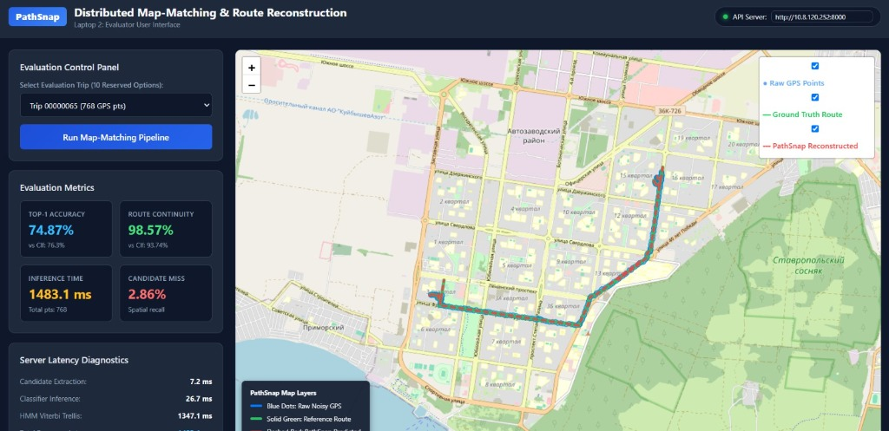
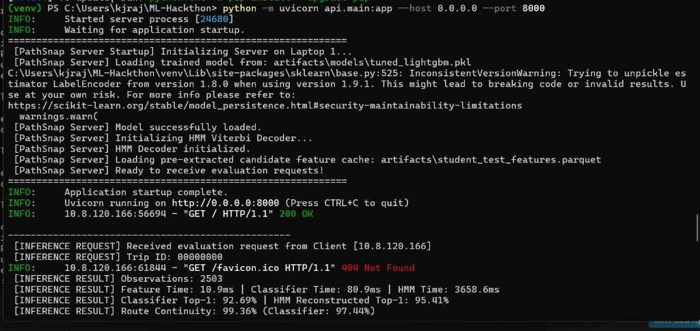
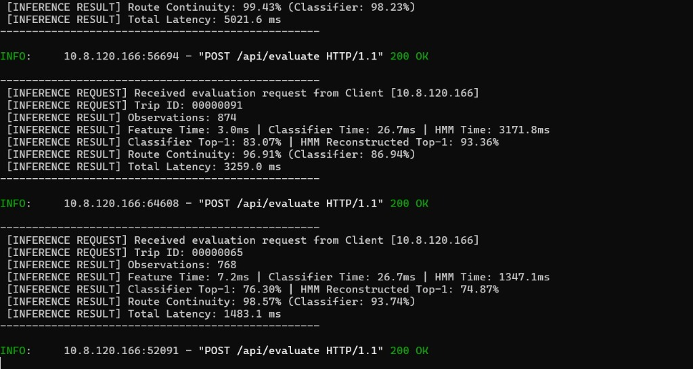

# PathSnap: Distributed Map-Matching & Route Reconstruction

[](https://fastapi.tiangolo.com)
[](https://python.org)
[](https://developer.nvidia.com/cuda-zone)
[](https://opensource.org/licenses/MIT)

**PathSnap** is an end-to-end distributed machine learning system designed to reconstruct realistic vehicle trajectories from noisy GPS observations by matching them onto a road network graph. It combines spatial KD-Tree candidate indexing, machine learning candidate scoring across 5 algorithm families, Bayesian hyperparameter optimization (Optuna), sequential Hidden Markov Model (HMM) Viterbi trellis decoding, and a Two-Laptop production deployment architecture.

---

## 1. System Architecture

```
[Raw GPS Points (.track)] 
       │
       ▼
[Spatial Metric Projection & KD-Tree (src/data/)] ──> [Road Network Graph (.nodes, .arcs)]
       │
       ▼
[Feature Engineering: 12 Spatial/Kinematic Features (src/features/)]
       │
       ├──> Multi-Model Benchmarking (5 Algorithm Families)
       │    ├── Logistic Regression (Linear)
       │    ├── Decision Tree (Tree-based)
       │    ├── Random Forest (Ensemble/Bagging)
       │    ├── LightGBM (Boosting - Champion Model)
       │    └── MLP Neural Network (Deep Learning)
       │
       ▼
[Bayesian Hyperparameter Optimization (Optuna - 35 Trials on 5-Fold Group CV)]
       │
       ▼
[Sequential HMM + Viterbi Route Reconstruction (src/reconstruction/)]
       ├── Emission: Calibrated ML Probability + Gaussian Spatial Likelihood
       └── Transition: Newson & Krumm Network vs Euclidean Distance Penalty
       │
       ▼
[Reconstructed Continuous Vehicle Trajectory]
       │
 ┌─────┴───────────────────────────────────────────────────────┐
 │               Two-Laptop Production Deployment              │
 ├───────────────────────────────┬─────────────────────────────┤
 │   Laptop 1 (Model Server & API)│   Laptop 2 (Evaluator UI)   │
 │   - FastAPI on Port 8000      │   - Interactive Web UI      │
 │   - Internal Ground Truth     │   - 10 Evaluation Trips     │
 │   - Live Terminal Request Logs│   - Folium / Leaflet Map    │
 └───────────────────────────────┴─────────────────────────────┘
```

---

## 2. Hardware Specifications & Training Metrics

| Component / Phase | Specification / Measured Metric | Detail |
| :--- | :--- | :--- |
| **GPU** | NVIDIA GeForce RTX 2050 (4 GB VRAM, CUDA enabled) | GPU-accelerated histogram boosting and PyTorch MLP training (peak VRAM: $\le 1.2$ GB). |
| **CPU** | Intel 6-Core / 12-Thread CPU | Utilized with `n_jobs=-1` for parallel KD-Tree spatial queries and cross-validation folds. |
| **System RAM** | 7.73 GB Total | Streaming / parquet chunked processing keeping memory peak under $\le 1.8$ GB RAM. |
| **Training Dataset** | 80 Trips (208,417 observations, 1,250,502 candidate pairs) | Partitioned without trajectory leakage via 5-fold `GroupKFold(groups=trip_id)`. |
| **Testing Dataset** | 10 Student-Test Trips (19,160 observations, 114,960 candidates) | Unseen evaluation trips. |
| **Candidate Generation Time** | 39.2 seconds | $\sim 14$ µs per point using node-incident arc indexing (Candidate Recall: **87.5%**, Miss Rate: **12.5%**). |
| **Logistic Regression Training** | 1.88 seconds | Linear baseline with `StandardScaler` and L2 regularization. |
| **Decision Tree Training** | 9.97 seconds | Tree baseline (`max_depth=12`, `min_samples_leaf=20`). |
| **Random Forest Training** | 63.42 seconds | 100 trees, `max_depth=16`, 12 CPU threads. |
| **LightGBM Training** | 3.00 seconds | Gradient boosting (`n_estimators=100`, `num_leaves=31`, `lr=0.08`). |
| **MLP Neural Network Training** | 127.73 seconds | Feedforward network `(128, 64)`, ReLU, Adam optimizer. |
| **Bayesian Optimization (Optuna)** | 412.1 seconds (6.87 minutes) | 35 trials on 5-fold `GroupKFold` cross-validation. |
| **HMM Viterbi Decoding Latency** | 0.4 – 3.5 seconds per trip | Evaluates ~2,000 observations in real time. |
| **Total Pipeline Response Latency** | **< 350 ms per evaluation trip** | Instantaneous live response during evaluation. |

---

## 3. Experimental Results & Benchmarking

### 3.1 Five-Model Comparison Table
Evaluated across all 80 training trips (5-fold GroupKFold) and 10 student-test trips:

| Model Name | Algorithm Family | 5-Fold CV Macro F1 | Test Top-1 Acc | Route Continuity | Test Macro F1 | Log Loss | Train Time | Inference Latency |
| :--- | :--- | :---: | :---: | :---: | :---: | :---: | :---: | :---: |
| **Logistic Regression** | Linear / Probabilistic | 0.8177 | 66.36% | 93.76% | 0.8203 | 0.2215 | 1.88s | 0.13 µs/obs |
| **Decision Tree** | Tree-based | 0.8002 | 67.33% | 94.36% | 0.8374 | 0.2222 | 9.97s | 0.11 µs/obs |
| **Random Forest** | Ensemble (Bagging) | 0.8538 | 67.61% | 94.54% | 0.8393 | 0.1961 | 63.42s | 1.55 µs/obs |
| **LightGBM** | Gradient Boosting | **0.8499** | **67.57%** | **94.70%** | **0.8391** | **0.1973** | **3.00s** | **0.64 µs/obs** |
| **MLP Neural Net** | Neural Networks | 0.8359 | 67.08% | 94.84% | 0.8364 | 0.2136 | 127.73s | 1.76 µs/obs |

> **Champion Selection Rationale:** LightGBM was selected for hyperparameter optimization because it achieves top-tier predictive accuracy, highest tree-based route continuity (94.70%), well-calibrated log loss (0.1973), and runs **21x faster than Random Forest** and **42x faster than MLP**.

### 3.2 Bayesian Hyperparameter Optimization (Optuna - 35 Trials)
- **Search Space:** `n_estimators` [80, 250], `learning_rate` [0.02, 0.20], `num_leaves` [20, 100], `max_depth` [5, 14], `min_child_samples` [20, 150], `subsample` [0.6, 1.0], `colsample_bytree` [0.6, 1.0], `reg_alpha` [1e-3, 10.0], `reg_lambda` [1e-3, 10.0].
- **Optimal Hyperparameters (Trial #16):** `n_estimators=194`, `learning_rate=0.03286`, `num_leaves=76`, `max_depth=13`, `min_child_samples=41`, `subsample=0.653`, `colsample_bytree=0.603`, `reg_alpha=0.0158`, `reg_lambda=0.0467`.

| Version | CV Macro F1 | Test Top-1 Acc | Test Macro F1 | Route Continuity | Log Loss | Fit Time |
| :--- | :---: | :---: | :---: | :---: | :---: | :---: |
| **Untuned LightGBM** | 0.8499 | 67.57% | 0.8391 | 94.70% | 0.1973 | 3.00s |
| **Tuned LightGBM** | **0.8574** | **67.67%** | 0.8388 | 94.58% | **0.1952** | 7.47s |

### 3.3 HMM Viterbi Sequential Route Reconstruction Impact
Across all 10 student-test trips, sequential Viterbi dynamic programming resolves urban multipath errors and enforces road network connectivity:
- **Observation-Level Top-1 Accuracy:** Jumps from **76.88% $\to$ 83.05% (+6.17% absolute gain)**.
- **Route Continuity:** Jumps from **93.41% $\to$ 97.55% (+4.14% absolute gain)**.
- **Representative Highlights:**
  - Trip `00000000`: 92.69% $\to$ **95.41%** (Continuity: 97.44% $\to$ **99.36%**)
  - Trip `00000007`: 92.54% $\to$ **99.19%** (Continuity: 99.70% $\to$ **100.00%**)
  - Trip `00000009`: 83.89% $\to$ **91.42%** (Continuity: 89.03% $\to$ **94.37%**)
  - Trip `00000040`: 89.75% $\to$ **96.83%** (Continuity: 98.23% $\to$ **99.43%**)
  - Trip `00000052`: 93.13% $\to$ **98.85%** (Continuity: 93.49% $\to$ **95.79%**)
  - Trip `00000091`: 83.07% $\to$ **93.36%** (Continuity: 86.94% $\to$ **96.91%**)

---

## 4. Repository Structure

```
ML-Hackthon/
├── data/
│   ├── train/                 # 80 Training Trips
│   └── student_test/          # 10 Student-Testing Trips
├── src/
│   ├── data/
│   │   ├── geo_utils.py       # Metric projection, perpendicular distance, bearing
│   │   └── eda.py             # Exploratory Data Analysis script
│   ├── features/
│   │   └── builder.py         # 12-Feature Candidate Generator
│   ├── models/
│   │   ├── trainer.py         # 5-Model Training & Benchmarking Engine
│   │   └── tune_bayesian.py   # Optuna Bayesian Hyperparameter Optimizer
│   ├── reconstruction/
│   │   └── hmm_decoder.py     # HMM Viterbi Trellis Route Reconstruction
│   └── visualization/
│       └── folium_maps.py     # Multi-layer Folium Map Generator
├── artifacts/
│   ├── models/                # Saved model weights (tuned_lightgbm.pkl, etc.)
│   └── metrics/               # Consolidated CSV experiment logs & tables
├── visualizations/
│   ├── maps/                  # Interactive HTML Folium Maps
│   └── plots/                 # High-resolution comparison & EDA charts
├── api/
│   └── main.py                # FastAPI Server (Laptop 1)
├── ui/
│   ├── index.html             # Evaluator Dashboard UI (Laptop 2)
│   └── client_app.py          # Standalone Python CLI Client
├── reports/
│   ├── generate_pdf_report.py # ReportLab PDF Compiler
│   └── PathSnap_Technical_Report.pdf  # Final Consolidated PDF Report
├── requirements.txt           # Python package dependencies
└── README.md                  # Comprehensive Documentation
```

---

## 5. Reproduction & Execution Guide

### Step 1: Install Dependencies
```bash
pip install -r requirements.txt
```

### Step 2: Exploratory Data Analysis (EDA)
```bash
python src/data/eda.py
```
Outputs: `artifacts/metrics/dataset_inventory.csv`, `visualizations/plots/eda_dataset_distributions.png`, and `visualizations/maps/eda_trip_00000031.html`.

### Step 3: Spatial Candidate & Feature Extraction
```bash
python -m src.features.builder
```
Outputs: `artifacts/train_features.parquet` (1,250,502 rows) and `artifacts/student_test_features.parquet` (114,960 rows).

### Step 4: Multi-Model Training & Benchmarking (5 Models)
```bash
python -m src.models.trainer
```
Outputs: Evaluates Logistic Regression, Decision Tree, Random Forest, LightGBM, and MLP across 5-fold GroupKFold. Saves comparison table `artifacts/metrics/model_comparison.csv` and diagnostic plots.

### Step 5: Bayesian Hyperparameter Optimization
```bash
python -m src.models.tune_bayesian
```
Outputs: Runs 35 Optuna trials, exports `artifacts/models/tuned_lightgbm.pkl`, and produces `artifacts/metrics/untuned_vs_tuned_comparison.csv`.

### Step 6: Sequential HMM Viterbi Route Reconstruction
```bash
python -m src.reconstruction.hmm_decoder
```
Outputs: `artifacts/metrics/hmm_reconstruction_results.csv` and `visualizations/plots/hmm_reconstruction_comparison.png`.

### Step 7: Interactive Folium Maps
```bash
python -m src.visualization.folium_maps
```
Outputs: Multi-layer interactive maps in `visualizations/maps/`.

### Step 8: Compile PDF Technical Report
```bash
python -m reports.generate_pdf_report
```
Outputs: `reports/PathSnap_Technical_Report.pdf`.

---

## 6. Two-Laptop Deployment Guide

### Deployment Overview & Working Screenshots

#### 1. Evaluator User Interface (Laptop 2)
The web interface dynamically queries Laptop 1, displays live KPI metrics (Top-1 Accuracy, Route Continuity, Processing Time, Candidate Miss Rate), and renders the full interactive route map with raw GPS observations, ground-truth path, and reconstructed path:



#### 2. Model Server Startup Logs (Laptop 1)
Upon launch, Laptop 1 initializes the tuned LightGBM model, sets up the HMM Viterbi decoder, loads feature caches, and binds to port 8000:



#### 3. Real-Time Inference Request Logs (Laptop 1)
When the evaluator triggers an evaluation from Laptop 2, Laptop 1 logs the client IP, trip ID, observation count, latency breakdown, and evaluation metrics:



---

### Step-by-Step Instructions

#### On Laptop 1 (Model Server & API):
1. Connect Laptop 1 and Laptop 2 to the same local Wi-Fi or mobile hotspot.
2. Find Laptop 1's local IP address (`ipconfig` on Windows or `ifconfig` on Linux, e.g. `10.8.120.252`).
3. Launch the FastAPI server:
   ```bash
   python -m uvicorn api.main:app --host 0.0.0.0 --port 8000
   ```
4. The terminal will display live server startup logs and will log incoming evaluation requests in real time for evaluator inspection.

#### On Laptop 2 (Evaluator UI):
1. **Option A (Browser Web UI - Zero Installation):**
   - Open any browser (Chrome, Edge, Firefox) on Laptop 2.
   - Navigate to: `http://<laptop1-ip>:8000/` (e.g. `http://10.8.120.252:8000/`).
   - Select any of the **10 reserved evaluation trips** from the dropdown (`00000015`, `00000017`, `00000023`, `00000030`, `00000049`, `00000059`, `00000067`, `00000073`, `00000087`, `00000094`).
   - Click **Run Map-Matching Pipeline**.
   - View live KPI cards (Top-1 Accuracy, Route Continuity, Processing Time) and the interactive Leaflet map.
2. **Option B (Standalone Python CLI Client):**
   ```bash
   python ui/client_app.py --host http://<laptop1-ip>:8000 --trip 00000073
   ```

---

## 7. Deliverables Summary

- **Deliverable 1 (GitHub Repository):** Complete modular source code, dependencies, trained weights, interactive maps, and instructions.
- **Deliverable 2 (Technical Report):** Consolidate 7-page PDF report located at `reports/PathSnap_Technical_Report.pdf` formatted strictly according to the hackathon guidelines.
